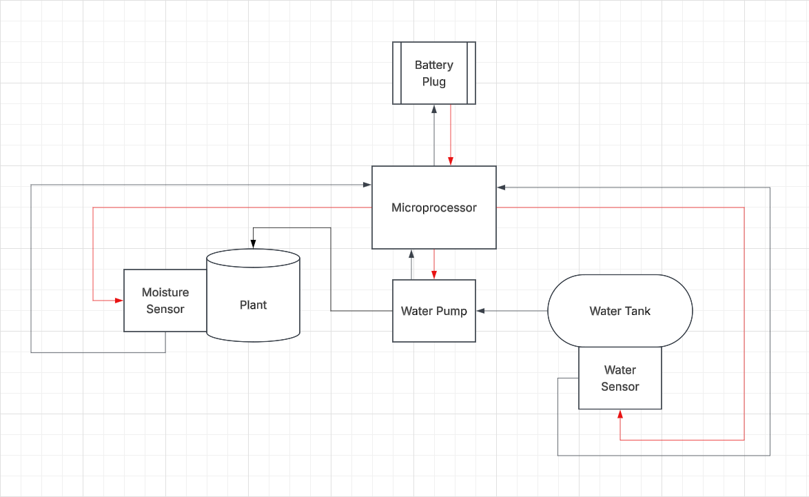
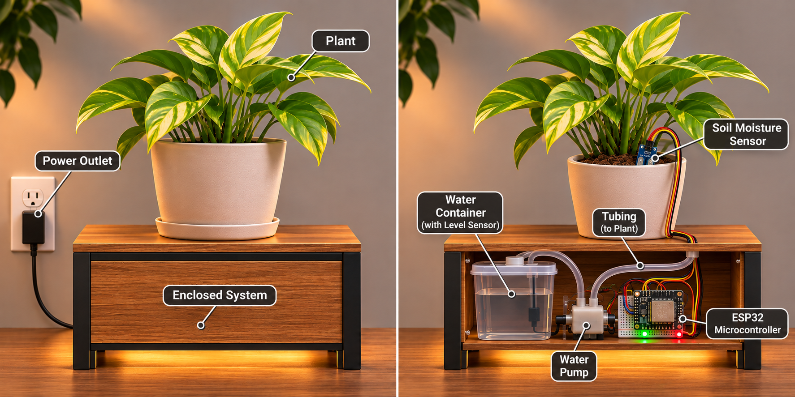

# Final-Project-EET3350
## Assignment Details
View [ProductDefinition.pdf](https://github.com/CalebNowowiejski/Final-Project-EET3350/blob/main/ProductDefinition.pdf)

## Team and Project Information

**Project:** Smart Plant Watering System

**Team Members:** Blaine Carner, Caleb Nowowiejski (Project Lead), Fiza Shaikh

**Meeting Times:**
- **Monday:** 2:20 PM – 3:55 PM
- **Wednesday (As Needed):** 2:20 PM – 3:55 PM

## Github Repository and Other Links

**Github:** [Final-Project-EET3350](https://github.com/CalebNowowiejski/Final-Project-EET3350/tree/main)

**Wokwi:** [Wokwi](https://wokwi.com/projects/new/esp32-s2)

## Chosen Project and Minimum Viable Product

The project our team selected is the **Smart Plant Watering System**. This system measures the moisture level of a plant's soil and determines whether the plant requires water, eliminating the constant need for manual watering. It will also include built-in logic to prevent both overwatering and underwatering. The system is primarily designed for homeowners with small potted plants, making it easier to maintain their plants' health while reducing the amount of manual work required. The only regular maintenance required from the user is ensuring that the water container is refilled when necessary. To assist with this, the system will monitor the water level and notify the user when the container needs to be refilled by displaying a red LED. This significantly reduces the effort required to properly care for plants. The essential components of the minimum viable product include an available power outlet, an ESP32 microcontroller, a water container, tubing, a soil moisture sensor, a water pump, and the necessary wiring. Potential improvements to the project could include wireless notifications, a display showing real-time soil moisture readings, customizable watering settings based on the type of plant, and the ability to monitor and water multiple plants using a single system.

## Team Feedback and Improvements

The original project idea has remained mostly unchanged. As a group, we discussed how the system would function and what components would be necessary. The main area we are still deciding on is the best method for transferring water from the container into the soil. We plan to explore different approaches to determine which would work best for our system. So far, we believe a wired water pump is the best approach. In the future, we would also like to implement a couple features: a feature that allows the microcontroller to send text message notifications to the user when the water container is empty and needs to be refilled and a feature that allows multiple plants to be tracked at the same time.

## Concept Block Diagram and Firmware Behavior

For the C programming, the microprocessor will communicate with the sensors to return the state of the water tanks and moisture levels to decide whether to activate the water pumps. For the water pump programming, if the moisture sensor reads a bad reading, the water pump will activate and using a while loop, the moisture sensor will continue to check the moisture level. For the water tank programming, after watering the plant, the microprocessor will check if the water tank needs to be refilled.

## Updated AI Concept Rendering

**AI Tool:** ChatGPT

**Prompt:** Generate a realistic 3D rendering of a Smart Plant Watering System with two side-by-side views. The left side should show a potted plant sitting on a stand with an enclosed compartment underneath and a power cable connected to a wall outlet. The right side should show the same stand with the front panel removed, revealing a water container with a water level sensor, a water pump, clear tubing that delivers water to the plant, and an ESP32 microcontroller with red and green LEDs. A soil moisture sensor should be inserted into the plant's soil, with visible wiring running through the stand and connecting directly to the ESP32. The power supply should connect to the microcontroller rather than the water pump. Include small, easy-to-read labels identifying the main components without overcrowding the image.

**Changes:** Removed OLED monitor, edited the water sensor, added water tank sensor, added power outlet to showcase power supply, and added hidden stand for a cleaner look.

## User Story, Tests, and Risks

**User Story:** As a homeowner with potted plants, I want an automated system that monitors soil moisture and waters my plants when necessary, so that I can keep my plants healthy without having to manually water them every day.

**Normal Operation Test:** The system starts with the water container filled and the soil moisture level below the acceptable range. The microcontroller requests a reading from the moisture sensor and determines that the soil is dry. It then activates the water pump to begin watering the plant while continuously monitoring the moisture level. Once the moisture reaches an acceptable level, the pump turns off, and the system records the time of watering. The test passes if the pump activates when the soil is dry, shuts off when the desired moisture level is reached, and successfully records the watering time.

**Exception Operation Test:** The system starts with dry soil and an empty water container. The microcontroller detects that the soil needs water and activates the water pump. However, the moisture level does not increase because no water is available. After a set amount of time without detecting an increase in moisture, the microcontroller should automatically shut off the pump to prevent damage and record an error. The test passes if the system detects the issue, shuts off the pump, and prevents further watering attempts until the problem is resolved. The test fails if the system does not detect the issue and allows the pump to continue running indefinitely while waiting for the desired moisture level to be reached.

**Failed Operation Test:** The system starts with dry soil and a full water container. The microcontroller requests a reading from the moisture sensor, but the sensor malfunctions and incorrectly reports that the soil has an acceptable moisture level. Because of this incorrect reading, the microcontroller does not activate the water pump, even though the plant requires water. The system continues operating normally without detecting or reporting an issue. The test fails because the plant does not receive the necessary water, and the system does not recognize that a malfunction has occurred.

**Technical and Safety Risks:** The main safety risk with this system is the combination of water and electricity. It is important to ensure that water cannot come into contact with the microcontroller, power outlet, or other electronic components. To test this, we can inspect the system for potential leaks and ensure all electrical components are properly protected. Another risk is the system failing to correctly water the plants, potentially causing them to become overwatered or underwatered. To test this, we can simulate different failures, such as an empty water container or a malfunctioning moisture sensor, and observe whether the system properly detects and responds to these issues.

## Schedule and Progress Checklist
11/23/26 | We updated the AI image and gave a description. We also created the block diagram and began to plan our C programming.
A week from today, during our next meeting, we will begin to write and test our C programming.
